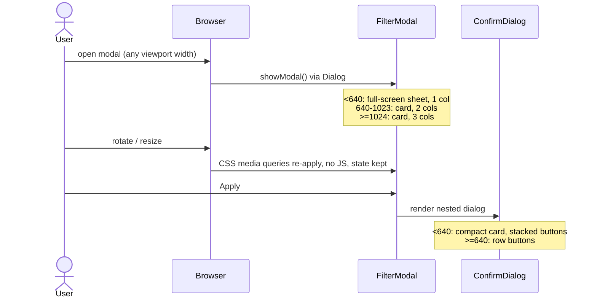

# Filter modal and confirm dialog adaptiveness

- Date: 2026-10-31
- Source: prompt (`/design-first Add adaptiveness to modals. Task name is filter-modal-adaptiveness`); builds on `docs/tasks/filter-modal/001_dfa_filter_modal.md` and the current code in `src/pages/Home/ui/`

## Decision log

| #   | Decision                 | Options considered                                                        | Decided by                          |
| --- | ------------------------ | ------------------------------------------------------------------------- | ----------------------------------- |
| 1   | Task name                | `filter-modal-adaptiveness` / `modals-adaptiveness` / `responsive-modals` | user                                |
| 2   | Design source            | derive from desktop / Figma mobile frames                                 | user: derive                        |
| 3   | Filter modal on phones   | full-screen sheet / centered card / bottom sheet                          | user: full-screen sheet             |
| 4   | Columns 1 / 2 / 3        | 1/2/3, 2/2/3, 1/3/3                                                       | user: 1/2/3                         |
| 5   | Confirm dialog on phones | compact card + stacked buttons / full-screen / side-by-side               | user: compact card, stacked buttons |
| 6   | Implementation approach  | Tailwind breakpoints (no JS) / `useMediaQuery` hook                       | user: Tailwind, no JS               |
| 7   | Option ordering          | column-first everywhere / row-first on small                              | user: column-first everywhere       |
| 8   | Verification             | manual viewport check / Vitest class assertions                           | user: manual check                  |
| 9   | Homepage scope           | only modals / minimal homepage tweaks                                     | user: minimal homepage tweaks too   |

Note on 6 + 7: "CSS grid utilities" and "column-first everywhere" are reconciled by using CSS multi-column (`columns-*`), which is also a Tailwind utility with no JS. It replaces the grid plus the inline `gridTemplateRows` style.

## 1. Feature description

### 1.1. Why?

The filter modal and the confirm dialog use desktop-only sizes: a 40px title, `p-8`, 3 fixed columns, 280px buttons, and a 120px gap in the confirm dialog. On phones and tablets the content overflows or is cramped, so the filter cannot be used there.

### 1.2. Goal

Both modals are usable from 320px to desktop widths:

- The desktop appearance (≥1024px) stays pixel-identical to the Figma-based implementation.
- Below 640px the filter modal is a full-screen sheet with a sticky header and a sticky Apply footer, and the confirm dialog is a compact card with stacked buttons.
- Option columns: 1 (<640px), 2 (640–1023px), 3 (≥1024px).

### 1.3. Challenges / Risks

- **No mobile design.** The values are derived and may differ from what a designer would choose; the rules are kept in one place so they are easy to tune.
- **Native `<dialog>`.** The browser UA stylesheet gives `dialog` fixed sizing and `display: none` when closed. Overrides must not break `showModal()` or backdrop-click detection in `Dialog`. Padding and `max-h` changes affect the "outside click" rect check.
- **Column-first order with `columns-*`.** Browsers balance multi-column content, so column heights may differ by one item compared with today's exact `ceil(n/3)` rows. A group's `legend` is floated, so `fieldset` plus `columns` must be checked for odd layout. Checkboxes must not split across columns (`break-inside-avoid`).
- **Mobile browser viewport.** `100vh` is wrong with dynamic toolbars; use `dvh` (already used in `max-h-dvh`).
- **Sticky footer inside a scrolling `<dialog>`.** Needs an opaque background and safe-area padding so it does not overlap content or sit under the iOS home indicator.
- **Reduced scope.** There is no Figma for mobile, so this is not a pixel-perfect mobile design.

## 2. Non-functional requirements

- **Usability:** touch targets ≥ 44×44px for buttons and option rows on touch widths; no horizontal scroll at 320px; body scroll stays locked by `showModal()`.
- **Accessibility:** no change in semantics (`dialog`, `aria-labelledby`, `fieldset`/`legend`). Focus order must not change. Sticky regions must not hide the focused control (`scroll-padding`).
- **Maintainability:** CSS only with Tailwind default breakpoints (`sm` 640, `lg` 1024). No new dependency, so there is nothing to document under the "new dependency" rule.
- **Performance:** no JS layout code; no runtime cost.

## 3. Sequence diagram

User-flow logic is unchanged (see the `filter-modal` DFA). The only new behaviour is how the layout reacts to the viewport:

## 4. Actions

All edits are className changes (plus removal of one inline style) under `src/pages/Home/ui/`.

1. **Update `FilterModal.tsx`**
   - `Dialog` className: `m-auto max-h-dvh w-full max-w-7xl overflow-y-auto rounded-card bg-white p-8 backdrop:bg-black/40` becomes
     `m-0 h-dvh max-h-none w-full max-w-none overflow-y-auto rounded-none bg-white p-4 backdrop:bg-black/40 sm:m-auto sm:h-auto sm:max-h-dvh sm:max-w-7xl sm:rounded-card sm:p-6 lg:p-8`
     - below `sm`: full-screen sheet (`m-0`, `h-dvh`, no radius)
     - from `sm`: centered card as today, with a scaled padding step
     - `m-0` is needed because the UA style gives `dialog` `margin: auto` and `max-width/height` calc values
   - Header: make it sticky on phones: `sticky top-0 z-10 bg-white` (kept non-sticky from `sm` with `sm:static`). Padding `pb-4 sm:pb-8`.
   - `h2`: `text-2xl sm:text-3xl lg:text-[40px]`; add `px-10 sm:px-0` and `text-center` so a long title does not run under the absolutely positioned close button.
   - Close button: min hit area `size-11` on touch widths (`-mr-2` to keep the visual alignment), `lg:size-auto`.
   - Footer: `sticky bottom-0 z-10 bg-white pt-4 pb-[max(1rem,env(safe-area-inset-bottom))] border-t border-grey-200 sm:static sm:border-0`. Apply button `w-full sm:w-[184px]`.
2. **Update `FilterGroup.tsx`**
   - `fieldset`: `py-6 sm:py-8`.
   - `legend`: `text-xl sm:text-2xl`, `mb-4 sm:mb-6`; allow the label row to wrap (`flex-wrap`).
   - Replace the options grid (`grid clear-both grid-flow-col grid-cols-3 gap-x-8 gap-y-4` plus inline `style={{ gridTemplateRows }}`) with
     `clear-both columns-1 gap-x-8 sm:columns-2 lg:columns-3`.
   - Remove the now-unused `rows` constant and the inline style.
3. **Update `OptionItem.tsx`**
   - Root element gets `break-inside-avoid` and a `pb-4` (replaces grid `gap-y-4`, which columns do not support).
   - Row min height `min-h-11` on touch widths (`lg:min-h-0`) so the whole label is a comfortable tap target.
   - Long names: `break-words` and `min-w-0` so the text wraps instead of overflowing at 320px.
4. **Update `ConfirmDialog.tsx`**
   - `Dialog` className: `m-auto w-full max-w-5xl rounded-card bg-white p-8 shadow-card backdrop:bg-black/40` becomes
     `m-auto w-[calc(100%-2rem)] max-w-5xl rounded-card bg-white p-4 shadow-card backdrop:bg-black/40 sm:w-full sm:p-8`
     (16px gutters on phones so it stays a card; `w-full` from `sm` as today).
   - `h2`: `text-2xl sm:text-3xl lg:text-[40px]`, `px-10 sm:px-0`.
   - Buttons container: `mt-[120px] flex justify-center gap-8` becomes
     `mt-8 flex flex-col-reverse gap-3 sm:mt-16 sm:flex-row sm:justify-center sm:gap-8 lg:mt-[120px]`
     (`flex-col-reverse` puts **Confirm** on top because it is last in the DOM; DOM and tab order are unchanged).
   - Buttons: `w-full sm:w-[280px]`; padding `px-6 py-4 sm:px-[49px] sm:py-[26px]`.
5. **Check `src/shared/components/Dialog/Dialog.tsx`** — no code change expected. Verify that the backdrop-click rect check still works when the dialog is full-screen (no "outside" area, so a click can only land inside; acceptable). Re-check after the className change.
6. **Check `src/main.css`** — no change expected; add `scroll-padding` only if sticky header/footer hide the focused checkbox (do it in the dialog className: `scroll-py-20`).
7. **Update `App.tsx` (minimal homepage tweaks)**
   - `main`: `p-8` becomes `p-4 sm:p-8`; `gap-8` becomes `gap-6 sm:gap-8`.
   - `h1`: `text-4xl` becomes `text-2xl text-center sm:text-4xl` (keeps the existing `text-gray-600` and the `eslint-disable` comment).
   - Open button: add `w-full sm:w-auto`; the wrapping `section` becomes `w-full items-center` so the button can stretch on phones.
   - Debug `<pre>`: already has `overflow-auto`; add `max-w-full` and keep `text-sm`, so long JSON scrolls inside the block and not the page.
8. **Docs:** update `docs/tasks/filter-modal-adaptiveness/` with `implementation_checklist.md` when `/implement` runs.

## 5. C4 diagrams

No architectural change. Not required.

## 6. Database structure

None.

## 7. API documentation

No change to the API, types, store, i18n keys or exported component signatures. `FilterModalProps`, `ConfirmDialogProps`, `FilterGroupProps` and `DialogProps` are unchanged. The only changes are the className strings of the components.

#### New

- none

#### Changed

- visual layout of `FilterModal`, `FilterGroup`, `OptionItem`, `ConfirmDialog` by viewport width (see section 4)

#### Removed

- inline `gridTemplateRows` style in `FilterGroup`

## 8. Test coverage requirements

- Existing Vitest suite and `pnpm build`, `pnpm lint:all`, `pnpm format:check:all` must stay green (CI runs all three on Node 18 and 20). jsdom cannot assert media-query layout, so there are no new automated tests (decision 8).
- **Manual viewport matrix** (browser devtools, Chrome and Safari/iOS if available) at 320, 375, 768, 1024 and 1280px, portrait and landscape:
  1. Filter modal: no horizontal scroll; columns are 1 / 1 / 2 / 3 / 3; the order reads column-first; the header and Apply stay visible while scrolling (<640).
  2. Desktop (≥1024) looks the same as before the change (compare with a screenshot taken beforehand).
  3. Pre-fill, toggling "All", Apply → confirm opens in the nested dialog on every width.
  4. Confirm dialog: buttons stacked with Confirm on top (<640); side by side from 640; the title does not collide with the close button.
  5. Close paths still work: Esc, close button, backdrop click (≥640), Discard, Confirm.
  6. Keyboard: Tab order unchanged; a focused checkbox is not hidden behind the sticky header/footer.
  7. Long option names wrap at 320px.
  8. Homepage at 320px: no horizontal page scroll; the open button is full width; long JSON scrolls inside the `<pre>`.

## 9. Impact summary

| Module                                    | Change                                                                       | Notes                       |
| ----------------------------------------- | ---------------------------------------------------------------------------- | --------------------------- |
| `src/pages/Home/ui/FilterModal.tsx`       | responsive dialog/header/footer/title classes                                | owner of the change         |
| `src/pages/Home/ui/FilterGroup.tsx`       | grid → `columns-1 sm:columns-2 lg:columns-3`, remove inline style and `rows` | owner of the change         |
| `src/pages/Home/ui/OptionItem.tsx`        | `break-inside-avoid`, spacing, touch height, text wrapping                   | owner of the change         |
| `src/pages/Home/ui/ConfirmDialog.tsx`     | responsive sizes, stacked buttons on phones                                  | owner of the change         |
| `src/shared/components/Dialog/Dialog.tsx` | no code change; backdrop-click logic re-verified                             | only touched (verification) |
| `src/main.css`                            | no change expected (`scroll-padding` only if needed)                         | only touched                |
| `src/pages/Home/ui/App.tsx`               | responsive padding, `h1` size, full-width open button, `pre` max width       | decision 9                  |
| Vitest suite, CI (build/format/lint)      | unchanged, must pass                                                         | regression gate             |

## 10. Open questions

none
