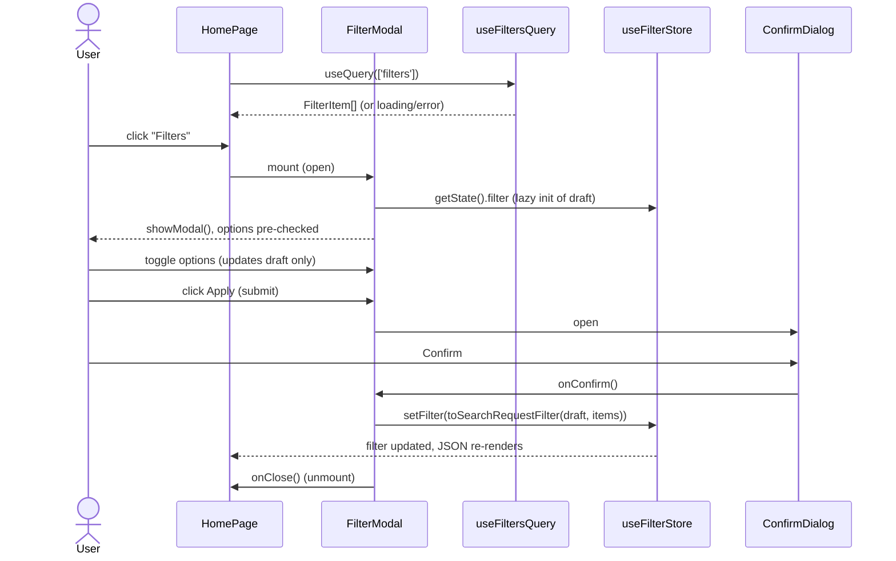

# Filter modal with confirm-to-save

- Date: 2026-10-29
- Design: [Figma copy](https://www.figma.com/design/R8UNAPt2XiM2mRgOlyYrQ2/WWT-Test-task--Copy-?node-id=1371-49053)
- Source: `README.md` (task text) and the Figma design, read through the Figma connector from the user's copy of the README file (`R8UNAPt2XiM2mRgOlyYrQ2`, nodes `1371:49053` modal, `8626:71715` confirm dialog). The original file (`cnBVURUTntc8peGEfKexoY`) is refused for lack of edit access. Details in section 10.

## Decision log

| #   | Decision                                                                                                                                                                                  | Options considered                      | Decided by                        |
| --- | ----------------------------------------------------------------------------------------------------------------------------------------------------------------------------------------- | --------------------------------------- | --------------------------------- |
| 1   | Saved filter lives in a zustand store, **in-memory only** (no `persist`)                                                                                                                  | in-memory / `persist` to localStorage   | User                              |
| 2   | Modal and confirmation built with native `<dialog>` + Tailwind                                                                                                                            | native `<dialog>` / headless library    | User                              |
| 3   | Filter data loaded with `useQuery` over a mock async `fetchFilters()`                                                                                                                     | `useQuery` / sync JSON import           | User                              |
| 4   | Figma is inspected for layout                                                                                                                                                             | inspect / skip                          | User; done, results in section 10 |
| 5   | Checkbox states: hover fills `#F2F2F2`, focus changes the border to the brand orange `#FF5F00`, checked fills the grey.500 text color `#31393C` with a tick in the modal background color | n/a                                     | User                              |
| 6   | The confirm dialog sits centered over the filter dialog with a dimmed backdrop, using the native `::backdrop`                                                                             | native `::backdrop` / custom overlay    | User                              |
| 7   | Scope: only the button and the JSON view on the homepage; pages and components not mentioned in the README (e.g. the Figma hero) are out of scope                                         | match the hero / minimal button         | User                              |
| 8   | Stricter alias convention: add `@api`, `@assets`, `@components`, `@pages`, `@store`, `@temp` (and any folder created later) to `tsconfig.json`                                            | `@/` only / `@folder/` aliases          | User                              |
| 9   | The zustand store lives in `src/shared/store`                                                                                                                                             | `pages/Home/model` / `shared/store`     | User                              |
| 10  | CI: no test step is added; the pipeline keeps its lint and format checks                                                                                                                  | add `vitest run` / lint and format only | User                              |
| 11  | No tests are required: section 8 is empty, no `setupTest.ts` polyfill                                                                                                                     | write tests / no tests                  | User                              |

## 1. Feature description

### 1.1. Why?

The WinWinTravel test task asks for a filter modal built from API filter data. It checks that the candidate can combine react-query, zustand, i18n and Tailwind with semantic, accessible markup.

### 1.2. Goal

- A button on the homepage opens a filter modal built from `filterData.json` (5 `OPTION` filters).
- The modal is pre-filled with the previously saved selection.
- `Apply` opens a confirmation dialog. Confirm saves to the global store and closes both dialogs. Cancel keeps the previous saved state.
- The homepage prints the saved filter as JSON (`SearchRequestFilter`).

### 1.3. Challenges / Risks

- **Design content differs from the data.** Figma shows 11 sections with different names (Preliminary filter, Popular filters, Amenities, …). `filterData.json` has 5 filters (Meal options, Rules/Policies/Payment, Facilities, Bed type, Health/Entertainment/Sports). The data drives the content; the design is the visual reference for structure and style.
- **Design inconsistencies the README asks us to normalise.** In Figma the columns start at different x offsets per section and the two-option "Form of payment" section is a single column. We use one grid rule for every section (section 10).
- **JSON vs types.** `filterData.json` is imported with `type: string`, while `FilterType` is a `const enum`. A cast (`as FilterItem[]`) or a small mapper is needed at the API boundary.
- **Stale ids.** Saved option ids may not exist in a later API response. Rendering must ignore them and `Apply` must drop them.
- **Two stacked modal dialogs.** The confirm dialog opens centered over the filter dialog with a dimmed native `::backdrop` (decision 6). Both use `showModal()`, so the browser top layer stacks them. Esc closes only the topmost.
- **Lint rules.** `i18next/no-literal-string` is an error, so every UI string goes through i18n. Option `name`/`description` come from the API and are rendered as data.

## 2. Non-functional requirements

- **Usability / a11y:** semantic HTML (`<dialog>`, `<form>`, `<fieldset>`/`<legend>`, checkboxes with `<label>`), focus trap and Esc via `showModal()`, focus returns to the trigger button on close.
- **Performance (Vercel React rules):**
  - `rerender-lazy-state-init` / `rerender-derived-state-no-effect`: the draft is initialised once from the store via a `useState` initialiser. The modal is mounted only while open, so each open starts from fresh saved data and no effect syncs store to draft.
  - `rerender-defer-reads`: the open button does not subscribe to the store; the modal reads `useFilterStore.getState().filter` in the initialiser. Only the JSON view uses a selector.
  - `rerender-no-inline-components`: `FilterGroup`, `ConfirmDialog` and `Dialog` are module-level components.
  - `js-set-map-lookups`: per-filter selection is checked through a `Set`.
  - `rendering-conditional-render`: use ternaries, not `&&`.
  - `bundle-barrel-imports`: barrels only as slice public APIs (the existing `pages/Home/index.ts` style); inside a slice, import files directly. The modal is not lazy-loaded; it is small and a lazy chunk would add a loading state for no gain.
- **Reliability:** loading, error and retry states for the query; a failed query disables the open button rather than opening an empty modal.
- No new runtime dependencies, so no dependency documentation is needed.

## 3. Sequence Diagram

### 3.1. Open, edit, apply, confirm



### 3.2. Cancel paths

```mermaid
sequenceDiagram
    actor User
    participant Modal as FilterModal
    participant Confirm as ConfirmDialog
    participant Store as useFilterStore

    User->>Modal: click Apply
    Modal->>Confirm: open
    User->>Confirm: Cancel / Esc
    Confirm->>Modal: onCancel()
    Note over Modal,Store: Store untouched; draft kept so the user can keep editing
    User->>Modal: Close / Esc
    Modal->>Modal: onClose() unmount, draft discarded
```

## 4. Actions

Paths follow the existing layout (`pages/`, `shared/`). Imports use the `@folder/` aliases from 4.0 (decision 8), as `CLAUDE.md` requires.

### 4.0. Path aliases

Add to `tsconfig.json` → `compilerOptions.paths` (keep `@/*`). `vite-tsconfig-paths` is already in `vite.config.ts`, so Vite picks them up with no further change. The names match the groups in `.prettierrc.json` (`importOrder`), so imports sort correctly.

| Alias           | Target                    | Used for                                                        |
| --------------- | ------------------------- | --------------------------------------------------------------- |
| `@api/*`        | `src/shared/api/*`        | `@api/filters`, `@api/types/Filter`, `@api/types/SearchRequest` |
| `@assets/*`     | `src/shared/assets/*`     | `CloseIcon`, `InfoIcon` SVGs                                    |
| `@components/*` | `src/shared/components/*` | `Dialog`                                                        |
| `@pages/*`      | `src/pages/*`             | `@pages/Home`                                                   |
| `@store/*`      | `src/shared/store/*`      | `useFilterStore`                                                |
| `@temp/*`       | `src/shared/temp/*`       | `filterData.json`                                               |

Any folder created during implementation gets its alias added in the same commit. i18n imports use `@/shared/i18n/...` (no alias group for it in the Prettier config).

### 4.1. Data layer

- Create `src/shared/api/filters/fetchFilters.ts`
  - `fetchFilters(): Promise<FilterItem[]>` resolves `filterData.json`'s `filterItems`, cast to `FilterItem[]` at this single boundary.
- Create `src/shared/api/filters/useFiltersQuery.ts`
  - `useQuery({ queryKey: filtersQueryKey, queryFn: fetchFilters, staleTime: Infinity })`; the data is static.
  - Export `filtersQueryKey = ['filters'] as const` (the `@tanstack/eslint-plugin-query` rules are enabled).
- Create `src/shared/api/filters/index.ts` exporting both.

### 4.2. Store

- Create `src/shared/store/filterStore.ts` and `src/shared/store/index.ts` (decision 9; imported as `@store/filterStore`)
  - `interface FilterState { filter: SearchRequestFilter; setFilter: (filter: SearchRequestFilter) => void }`
  - `useFilterStore = create<FilterState>()(...)`; initial `filter: []`. No `persist` (decision 1).

### 4.3. Pure helpers (pure functions, no React)

Create `src/pages/Home/model/filterDraft.ts`:

- `type FilterDraft = Record<string, ReadonlySet<string>>`, keyed by filter id.
- `toDraft(saved: SearchRequestFilter): FilterDraft`
- `toggleOption(draft, filterId, optionId): FilterDraft` (immutable, returns a new object).
- `toggleAll(draft, filter: FilterChoose): FilterDraft` (all selected → clear, else select all) for `allowAll`.
- `toSearchRequestFilter(draft, items: FilterItem[]): SearchRequestFilter`
  - Iterates `items` in API order, keeps only option ids that still exist, and skips filters with zero selected. Output: `{ id, type: FilterType.OPTION, optionsIds }`.

### 4.4. UI components

Module-level components, arrow functions, named exports. `Dialog` is generic and lives in `src/shared/components/Dialog/`; the filter-specific components live under `src/pages/Home/ui/`.

- `Dialog` (`@components/Dialog`): thin wrapper over `<dialog>`; props `{ onClose: () => void; children }`. Calls `ref.current.showModal()` in a mount effect and listens to the native `close`/`cancel` events to call `onClose`. Labelled via `aria-labelledby`.
- `FilterModal.tsx`: props `{ items: FilterItem[]; onClose: () => void }`.
  - `const [draft, setDraft] = useState(() => toDraft(useFilterStore.getState().filter))`.
  - `const [isConfirming, setConfirming] = useState(false)`.
  - Renders `<Dialog><form onSubmit>` with one `FilterGroup` per item, plus Close and Apply (`type="submit"`) buttons. `onSubmit` does `preventDefault()` then `setConfirming(true)`.
  - On confirm: `setFilter(toSearchRequestFilter(draft, items))`, then `onClose()`.
  - Renders `<ConfirmDialog>` only while `isConfirming` (ternary).
- `FilterGroup.tsx`: `<fieldset>` with `<legend>{item.name}</legend>`, optional description, and a checkbox plus `<label>` per option (name and description). For `allowAll`, a first "All" checkbox that calls `toggleAll`. Checked state is `draft[item.id]?.has(option.id)`.
- `ConfirmDialog.tsx`: props `{ onConfirm; onCancel }`; wraps `Dialog` with title, text, Confirm and Cancel.
- Update `App.tsx` (the homepage); scope is only the open button and the JSON view (decision 7), not the Figma hero.
  - Keep the existing `<section>`/`<h1>`.
  - `useFiltersQuery()`; "Filters" button (`aria-haspopup="dialog"`) disabled while the query is loading or failed; `useState` for open.
  - `{isOpen && data ? <FilterModal items={data} onClose={...} /> : null}`.
  - A `<section>` with a heading and `<pre><code>{JSON.stringify(filter, null, 2)}</code></pre>`, where `filter = useFilterStore((state) => state.filter)`.
  - Show a loading or error message with a retry button (`refetch`).

### 4.5. i18n

- Fill `src/shared/i18n/locales/en/filter.json` (currently `{}`) with keys and the exact copy from Figma:
  - `title`: "Filter", `apply`: "Apply", `close`: "Close" (accessible name of the close icon button)
  - `confirm.title`: "Do you want to apply new filter", `confirm.yes`: "Apply new filter", `confirm.no`: "Use old filter"
  - non-design keys: `open`, `all`, `loading`, `error`, `retry`, `debugTitle`
  - Use `useTranslation('filter')`.
- Fix `src/i18next.d.ts` imports (`../public/locales`, `./constants` do not exist) to `@/shared/i18n/locales` and `@/shared/i18n/i18nConstants` so `t()` is typed. This is currently hidden by `skipLibCheck`; verify `pnpm build` after the change.

### 4.6. Tooling

- The CI pipeline already runs build, `format:check:all` and `lint:all` on push/PR, which satisfies the "GitHub Action" requirement. No test step is added (decision 10).
- Commits follow Conventional Commits (e.g. `feat(filter): add filter store`).

## 5. C4 diagrams

Not required. No new containers or external systems; this is a single SPA with in-process state and a mocked API.

## 6. Database structure

Not applicable. State is in-memory only; no persistence layer.

## 7. API documentation

No HTTP API. Exported signatures:

#### New

- `fetchFilters(): Promise<FilterItem[]>`
- `useFiltersQuery(): UseQueryResult<FilterItem[]>`
- `useFilterStore` (`@store/filterStore`): `UseBoundStore<StoreApi<{ filter: SearchRequestFilter; setFilter(filter: SearchRequestFilter): void }>>`
- `toDraft`, `toggleOption`, `toggleAll`, `toSearchRequestFilter` (see 4.3)
- Components: `FilterModal({ items, onClose })`, `FilterGroup`, `ConfirmDialog({ onConfirm, onCancel })`, `Dialog({ onClose, children })`

Output shape shown on the homepage (`SearchRequestFilter`):

```json
[
	{
		"id": "MEAL_OPTIONS",
		"type": "OPTION",
		"optionsIds": ["breakfast", "dinner"]
	},
	{ "id": "FACILITIES", "type": "OPTION", "optionsIds": ["wi-fi"] }
]
```

#### Changed

- `App` (`pages/Home/ui/App.tsx`): adds the open button, modal mount and JSON view.

#### Removed

- None.

## 8. Test coverage requirements

Not required for this task (decision 11). No tests are written and no test tooling changes are made; existing coverage is untouched.

## 9. Impact summary

| Module                                                          | Change                                                                 | Notes                                   |
| --------------------------------------------------------------- | ---------------------------------------------------------------------- | --------------------------------------- |
| `src/pages/Home/ui/App.tsx`                                     | open button, modal mount, JSON view, query states                      | owner of the change                     |
| `src/pages/Home/ui/{FilterModal,FilterGroup,ConfirmDialog}.tsx` | new                                                                    |                                         |
| `src/shared/components/Dialog/*`                                | new generic `<dialog>` wrapper                                         | alias `@components`                     |
| `src/shared/store/{filterStore,index}.ts`                       | new zustand store                                                      | in-memory, alias `@store`               |
| `tsconfig.json`                                                 | `paths`: `@api`, `@assets`, `@components`, `@pages`, `@store`, `@temp` | see 4.0                                 |
| `src/pages/Home/model/filterDraft.ts`                           | new pure helpers                                                       | pure functions                          |
| `src/shared/api/filters/*`                                      | new `fetchFilters`, `useFiltersQuery`                                  | wraps `src/shared/temp/filterData.json` |
| `src/shared/i18n/locales/en/filter.json`                        | new keys                                                               | currently `{}`                          |
| `src/i18next.d.ts`                                              | fix import paths                                                       | enables typed `t()`                     |
| `src/main.css`                                                  | Tailwind `@theme` tokens (colors, radius, shadow, Inter font)          | see section 10.1                        |
| SVG assets (`CloseIcon`, `InfoIcon`)                            | new, downloaded from Figma                                             | svgr, `Icon` suffix                     |
| `src/shared/api/types/Filter`, `SearchRequest`                  | consumed, unchanged                                                    | only touched                            |
| `src/query.ts`, `src/main.tsx`                                  | consumed, unchanged                                                    | `QueryClientProvider` already wired     |
| `.github/workflows/pipeline.yml`                                | unchanged (no test step)                                               | already satisfies the CI requirement    |

## 10. Design reference (Figma)

Design copy: [WWT Test task (Copy)](https://www.figma.com/design/R8UNAPt2XiM2mRgOlyYrQ2/WWT-Test-task--Copy-?node-id=1371-49053) (original from the README: [WWT Test task](https://www.figma.com/file/cnBVURUTntc8peGEfKexoY/WWT-Test-task?type=design&node-id=0%3A1&mode=design), no edit access for the connector).

Values read from the design; the filter modal is node `1371:49053` (the `Pop-Up` frame, 1280 wide) and the confirmation card is node `8626:71715`. Colors and type map to Tailwind v4 theme tokens in `src/main.css` (`@theme`), not to hard-coded values in components.

### 10.1. Tokens

| Token                           | Value                                                                                                                           |
| ------------------------------- | ------------------------------------------------------------------------------------------------------------------------------- |
| Text / grey.500                 | `#31393C`                                                                                                                       |
| Text / grey.400 (cancel button) | `#474747`                                                                                                                       |
| Border / grey.200               | `#B4B4B4`                                                                                                                       |
| Brand / buttons.200             | `#FF5F00`                                                                                                                       |
| Surface                         | `#FFFFFF`                                                                                                                       |
| Shadow (confirm card)           | `0 2px 12px rgba(0,0,0,0.14)`                                                                                                   |
| Radius                          | 16px (cards and buttons)                                                                                                        |
| Font                            | Inter: Medium 40 (dialog title), Medium 24 (section title), Regular 16 (option label), Semi Bold 16 (buttons), line-height 100% |

### 10.2. Filter modal

- Card: white, radius 16, padding 32. Title "Filter" 40px Medium centered; close icon button 24px, vertically aligned with the title at the right edge. A 1px divider sits under the title.
- Section (one per `FilterItem`): 32px vertical padding, 1px divider below. Title 24px Medium; 24px gap to the options.
- Options: **3 columns, filled column by column** (items 1..n go down the first column, then the second). The design shows `rows = ceil(n / 3)`: 6 options → 2 rows, 14 → 5 rows, 4 → 2 rows, 3 → 1 row. Implementation: `grid grid-cols-3 gap-x-8 gap-y-4 grid-flow-col` with `grid-template-rows: repeat(ceil(n/3), auto)` set from the option count. The column gap is 32px (column pitch 416px in a 1216px content width). One rule for every section normalises the design's inconsistent offsets and the single-column "Form of payment" (README: make indents consistent).
- Option row: 24px checkbox, 16px gap, label 16px Regular; 16px gap between rows. Use a real `<input type="checkbox">` styled with Tailwind (`appearance-none`, 24px, `#B4B4B4`-style border), not the exported SVG, so semantics and keyboard behaviour stay native.
- Checkbox states (decision 5):

  | State                   | Style                                                                               |
  | ----------------------- | ----------------------------------------------------------------------------------- |
  | default                 | transparent fill, `#B4B4B4`-style border                                            |
  | hover                   | background `#F2F2F2`                                                                |
  | focus (`focus-visible`) | border color `#FF5F00` (brand)                                                      |
  | checked                 | background grey.500 `#31393C`, tick in the modal background color (white `#FFFFFF`) |

  The tick is drawn with a CSS mask/background on `:checked`; no extra DOM.

- Apply button: 184px wide, radius 16, `#FF5F00`, white 16px Semi Bold, centered, 32px below the last divider, 40px to the card bottom.
- The section title may carry a 16px info icon (seen on "Nutrition", `Vector 8626:71577`). It is the hook for the filter `description`.

### 10.3. Confirmation dialog

- Placement: centered over the filter dialog with a dimmed native `::backdrop` (decision 6).
- Card 1280×296 in the design: white, radius 16, padding 32, shadow above. Title "Do you want to apply new filter" (40px Medium, centered) with a close icon; 120px gap; two 280px buttons side by side with a 32px gap.
- Secondary ("Use old filter"): white background, 2px `#B4B4B4` border, `#474747` text, radius 16, padding 26/49. Primary ("Apply new filter"): `#FF5F00`, white text. The primary button confirms; the secondary and the close icon cancel.
- The design copy ("Use old filter") differs from a generic "Cancel"; the i18n keys in 4.5 use the design copy.

### 10.4. Assets

- Close icon (`8cf27.svg`), info icon (`fc626.svg`) and the divider line are exported by Figma with temporary URLs (valid 7 days). Download them into the repo at implementation time and import as svgr components with the `Icon` suffix (e.g. `CloseIcon`, `InfoIcon`), as `CLAUDE.md` requires. Dividers become a Tailwind `border-b`, not an image.
- Do not hotlink Figma URLs.

## 11. Additional information

### Future extension

Persistence is a one-line change later (wrap the creator in zustand `persist`), at the cost of a stale-id check on hydration.
