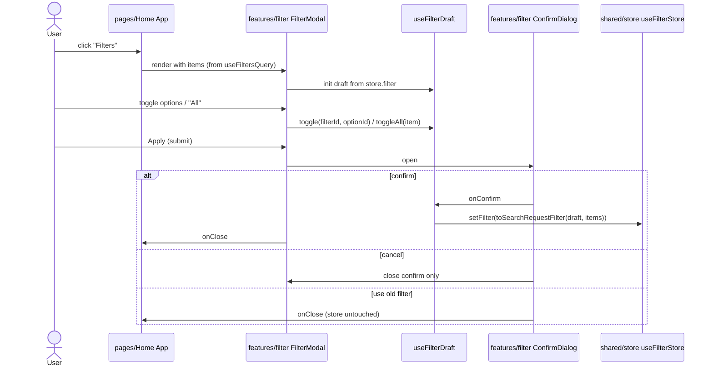
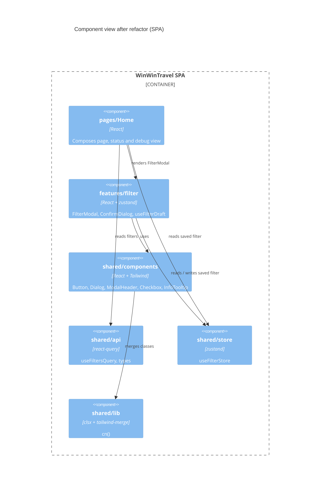

# Refactor filter modal: duplications, smells, structure

- Date: 2026-11-01
- Source: prompt (`/design-first refactore code identifying duplications, code smells, structure issues`); builds on `docs/tasks/filter-modal/` and `docs/tasks/filter-modal-adaptiveness/` and on the current code in `src/`
- Status: ready for implementation (no open questions)

## Decision log

| #   | Decision         | Options considered                                                          | Decided by                                         |
| --- | ---------------- | --------------------------------------------------------------------------- | -------------------------------------------------- |
| 1   | Task name        | `refactor-filter-modal` / `code-quality-refactor` / `refactor-duplications` | user: `refactor-filter-modal`                      |
| 2   | Structural depth | light (keep `pages/Home`) / medium (feature slice) / minimal (in place)     | user: medium, feature slice                        |
| 3   | Class handling   | local `cx` helper / `clsx` + `tailwind-merge` / leave `Button`              | user: `clsx` + `tailwind-merge` behind `cn()`      |
| 4   | Extra scope      | unused deps, i18n config, type/barrel smells, tests + CLAUDE.md             | user: first three, plus CLAUDE.md refresh          |
| 5   | Tests            | unit only / unit + modal flow / none                                        | user: no tests (lint + tsc + build + manual check) |
| 6   | Slice shape      | `features/filter` with `@features` alias / slice also owns API and store    | user: `features/filter`; API and store stay shared |

Note on 3: this adds two dependencies, so the README documents why and what for (section 4, action 3).

## 1. Feature description

### 1.1. Why?

The filter modal works, but the code written during the first task and the adaptiveness task has accumulated duplication, inconsistent imports and misplaced responsibilities. The filter feature lives inside `pages/Home`, and the page file mixes loading, error and debug UI. Cleaning this up now keeps later filter types (`FilterItem` is meant to grow beyond `FilterChoose`) cheap to add.

### 1.2. Goal

Behaviour and appearance stay identical (a pure refactor). The code has:

- no duplicated markup, helper logic or class strings;
- the filter feature isolated in `src/features/filter`, with `pages/Home` only composing it;
- consistent imports (aliases, barrels, no cycles) and no dead code or unused dependencies;
- `CLAUDE.md` matching the real repo.

### 1.3. Challenges / Risks

- **No automated tests** (decision 5). Regressions are only caught by `tsc`, lint, build and a manual check of open, select, "All", apply, confirm, cancel and discard at 320, 768 and 1280px. The manual checklist is in section 8.
- **`tailwind-merge` changes class resolution.** Today `Button` joins strings, so `className` is appended and wins only by CSS order. With `twMerge` conflicting utilities are removed. Existing overrides (`w-full max-w-[280px] sm:w-[280px]`, `max-w-[280px] sm:w-auto`) must render the same; check them visually.
- **Moving files breaks imports and the Prettier import sort.** Do the move as its own commit (`git mv`) so history stays readable.
- **Type barrels.** Removing `from '.'` cycles in `Filter/*` must not change the `const enum FilterType` inlining (`isolatedModules` is on; `const enum` is imported from a `.ts` file, so keep that import direct).
- **i18n typing.** `defaultNS` is `translation`, which has no resource. Changing it to a real namespace can turn existing `t()` calls into type errors; check with `tsc`.
- **Lockfile churn.** Removing three dependencies and adding two must be a single, reviewed `pnpm-lock.yaml` change.

## 2. Non-functional requirements

- **Maintainability:** one source of truth for each repeated piece; `features/*` must not import from `pages/*`.
- **Performance:** no change. `cn()` runs per render of a few components; `twMerge` caches results.
- **Bundle:** removing `date-fns`, `immer` and `react-router(-dom)` has no bundle effect (never imported), only install size. `clsx` (~0.3 kB) and `tailwind-merge` (~6 kB gzip) are added.
- **Accessibility:** semantics unchanged (`dialog`, `aria-labelledby`, `fieldset`/`legend`, label-for-input).

## 3. Sequence diagram

The runtime flow is unchanged. Only the owners of each step move:



## 4. Actions

### Findings (what the refactor fixes)

| #   | Type        | Finding                                                                                                                                                                                                                              | Where                                       |
| --- | ----------- | ------------------------------------------------------------------------------------------------------------------------------------------------------------------------------------------------------------------------------------ | ------------------------------------------- |
| F1  | Duplication | Dialog header (relative flex header, `<h2>` with the same size classes, 44px close button with `CloseIcon`) is copied                                                                                                                | `FilterModal.tsx`, `ConfirmDialog.tsx`      |
| F2  | Duplication | Checkbox + `<label htmlFor>` pair (24px `filter-checkbox`, gap, id wiring) is built twice                                                                                                                                            | `FilterGroup.tsx` ("All"), `OptionItem.tsx` |
| F3  | Duplication | Info icon in a `<span title>` is built twice; `OptionItem` also sets `title` on the row and on the span                                                                                                                              | `FilterGroup.tsx`, `OptionItem.tsx`         |
| F4  | Duplication | "All selected" rule (`options.every(has)`) is written in two places                                                                                                                                                                  | `FilterGroup.tsx`, `filterDraft.toggleAll`  |
| F5  | Duplication | Repeated class strings: dialog card (`rounded-card bg-white backdrop:bg-black/40`), action buttons (`w-full max-w-[280px] sm:w-[280px]`)                                                                                             | `FilterModal.tsx`, `ConfirmDialog.tsx`      |
| F6  | Smell       | `FilterModal` mixes dialog markup, draft state, store writes (`useFilterStore.getState()` in a component) and inline lambdas                                                                                                         | `FilterModal.tsx`                           |
| F7  | Smell       | `App.tsx` mixes the page shell, async status UI (loading / error / retry) and the debug JSON view; raw `<button>` for retry bypasses `Button`                                                                                        | `App.tsx`                                   |
| F8  | Smell       | `OptionItem`: redundant `key` on the inner `div`; `itemId`/`option` prop naming leaks the filter id; imports `@/shared/api/...` instead of `@api/...`; `FilterGroup` imports `./OptionItem.tsx` with extension                       | `OptionItem.tsx`, `FilterGroup.tsx`         |
| F9  | Smell       | `Button` builds `className` with `[...].filter(Boolean).join(' ')`, so overrides are order-dependent                                                                                                                                 | `Button.tsx`                                |
| F10 | Structure   | Feature code (`FilterModal`, `FilterGroup`, `OptionItem`, `ConfirmDialog`, `filterDraft`) lives under `pages/Home`; page and feature are not separable                                                                               | `src/pages/Home/{ui,model}`                 |
| F11 | Structure   | Circular barrel imports `from '.'` inside `Filter/` types; `FilterVariants.ts` holds one type under a vague name; `FilterItem = FilterChoose` alias in its own file; `SearchRequest/` has no barrel and is imported by deep path     | `src/shared/api/types/*`                    |
| F12 | Smell       | `fetchFilters` casts JSON with `as FilterItem[]`; mock import path `@temp` is reachable from API code                                                                                                                                | `fetchFilters.ts`                           |
| F13 | Config      | i18n: `debug: true` always on; `defaultNS: 'translation'` has no resource; `not-found.json` is registered but unused; every component repeats `useTranslation('filter')`                                                             | `i18n.ts`, `locales/en/index.ts`            |
| F14 | Dead code   | `date-fns`, `immer`, `react-router`, `react-router-dom` are not imported anywhere in `src`                                                                                                                                           | `package.json`                              |
| F15 | Docs        | `CLAUDE.md` is stale: says `src/i18next.d.ts` imports nonexistent paths and that only `@/*` is defined, but `src/shared/i18n/i18n.d.ts` and the extra aliases exist; no mention of shared components, the store or the feature slice | `CLAUDE.md`                                 |

### Implementation steps

Order matters: each step ends with `pnpm lint:all` + `pnpm build` passing, so it can be its own Conventional Commit.

1. **Dependencies and `cn()`** (`refactor:`/`build:`)
   - `pnpm add clsx tailwind-merge`; `pnpm remove date-fns immer react-router react-router-dom`.
   - Create `src/shared/lib/cn.ts`: `export const cn = (...inputs: ClassValue[]) => twMerge(clsx(inputs))`; add `src/shared/lib/index.ts`.
   - Add alias `@lib/*` → `./src/shared/lib/*` to `tsconfig.json` (`vite-tsconfig-paths` picks it up).
2. **Document the dependencies (project rule)**
   - Add a "Dependencies" section to `README.md`: `clsx` composes conditional class names; `tailwind-merge` resolves conflicting Tailwind utilities so a caller's `className` reliably overrides component defaults; both are used only through `cn()`. Note the removal of the three unused packages.
3. **Update `Button`** (F9): use `cn(BASE, VARIANT[variant], SIZE[size], className)`. Visual check of every `className` override in use.
4. **Shared UI primitives** (`src/shared/components/`, each with `index.ts`)
   - `ModalHeader` (`titleId`, `title`, `closeLabel`, `onClose`, optional `className`) renders the `<header>`, `<h2 id>` and close button (F1). The sticky variants from `FilterModal` are passed via `className`.
   - `Checkbox` (`id`, `label`, `checked`, `onChange`, optional `className`) renders the input + label pair (F2). Keeps the `filter-checkbox` CSS class.
   - `InfoTooltip` (`description`) renders `<span title>` with `InfoIcon` (F3). `OptionItem` drops the duplicate `title` on its row.
   - `ModalActions`/shared dialog class constants: either a `DIALOG_CARD_STYLES` constant exported by `Dialog` or a `variant` prop on `Dialog`; pick whichever removes the duplicate strings without adding a prop used once (F5). Button width classes become a `BUTTON_WIDTH` constant local to `ConfirmDialog`.
5. **Create the feature slice** (F10)
   - Add alias `@features/*` → `./src/features/*`.
   - `git mv` into `src/features/filter/`:
     - `ui/FilterModal.tsx`, `ui/FilterGroup.tsx`, `ui/OptionItem.tsx` → `ui/FilterOption.tsx`, `ui/ConfirmDialog.tsx`
     - `model/filterDraft.ts`
   - Add `src/features/filter/index.ts` exporting only `FilterModal`.
   - `pages/Home` keeps `index.ts` and `ui/App.tsx` only.
6. **Extract state logic** (F4, F6)
   - In `model/filterDraft.ts` add `isAllSelected(draft, filter)`; `toggleAll` and `FilterGroup` both use it.
   - Create `model/useFilterDraft.ts`: `useFilterDraft(items)` returns `{ draft, toggle, toggleAll, save }`. It initialises from `useFilterStore` (hook selector read once via lazy `useState`), and `save()` calls `setFilter(toSearchRequestFilter(draft, items))`.
   - `FilterModal` becomes markup + `isConfirming` state; handlers come from the hook, with no inline lambdas passed down. `FilterGroup` receives `isChecked`/`isAllSelected` derived by the parent or computes them via `isAllSelected`.
7. **Slim the page** (F7)
   - Create `pages/Home/ui/FiltersStatus.tsx` (loading text, error alert + retry `Button`) and `pages/Home/ui/SavedFilterDebug.tsx` (the `<pre><code>` view); `App.tsx` only composes them and owns `isOpen`.
8. **Types and API** (F11, F12)
   - `FilterBase.ts`, `FilterVariants.ts`: import siblings directly (`./FilterType`), no `from '.'`.
   - Rename `FilterVariants.ts` → `FilterChoose.ts`; keep the barrel `Filter/index.ts` API unchanged. Inline `FilterItem` into `FilterItem.ts` as `export type FilterItem = FilterChoose` with a direct import (kept as the extension point for more variants).
   - Add `SearchRequest/index.ts`; consumers import from `@api/types/SearchRequest`.
   - `fetchFilters`: type the JSON once (`satisfies`/typed constant in a `filterData.ts` mock module under `shared/temp`) and drop the `as` cast, or validate the shape in a single typed helper.
   - Replace `@/shared/api/...` imports with `@api/...`; remove `.tsx` extension imports.
9. **i18n config** (F13)
   - `debug: import.meta.env.DEV`.
   - Remove `not-found` from `locales/en/index.ts` and delete `not-found.json` (unused; re-add when a 404 page exists), or keep it if the user prefers; default is delete.
   - Set `defaultNS` to `'filter'` (the only real namespace), or keep `translation` with a note; verify `tsc`. Components then call `useTranslation()` without repeating the namespace only if that stays type-safe; otherwise keep `useTranslation('filter')`.
10. **Docs** (F15)
    - Refresh `CLAUDE.md`: current file layout (`features/filter`, `shared/{api,assets,components,i18n,lib,store,temp}`), the real alias list, the `i18n.d.ts` path, the `cn()` convention, and remove the stale i18n note.
    - Update `docs/tasks/filter-modal/*` only if they reference moved paths (add a one-line pointer to this task; do not rewrite history).
11. **Verify**: `pnpm lint:all`, `pnpm format:check:all`, `pnpm build`, then the manual checklist in section 8.

Target layout after the refactor:

```text
src/
  features/filter/
    index.ts
    model/{filterDraft.ts,useFilterDraft.ts}
    ui/{FilterModal,FilterGroup,FilterOption,ConfirmDialog}.tsx
  pages/Home/{index.ts,ui/{App,FiltersStatus,SavedFilterDebug}.tsx}
  shared/
    api/{filters,types}
    assets/  components/{Button,Dialog,ModalHeader,Checkbox,InfoTooltip}
    i18n/  lib/cn.ts  store/  temp/
```

## 5. C4 diagrams

Container level is unchanged (one SPA). Component level shows the new dependency direction (`pages` → `features` → `shared`, never the reverse):



## 6. Database structure

No database. No changes.

## 7. API documentation

No HTTP API. Exported signatures (component and hook contracts):

#### New

- `cn(...inputs: ClassValue[]): string` (`@lib/cn`)
- `ModalHeader({ titleId, title, closeLabel, onClose, className? })` (`@components/ModalHeader`)
- `Checkbox({ id, label, checked, onChange, className? })` (`@components/Checkbox`)
- `InfoTooltip({ description })` (`@components/InfoTooltip`)
- `useFilterDraft(items: FilterItem[]): { draft: FilterDraft; toggle(filterId, optionId): void; toggleAll(item: FilterChoose): void; save(): void }` (`@features/filter`, internal)
- `isAllSelected(draft: FilterDraft, filter: FilterChoose): boolean` (`filterDraft.ts`)
- `FiltersStatus`, `SavedFilterDebug` (page-local components)
- Aliases `@features/*`, `@lib/*`; barrel `@api/types/SearchRequest`

#### Changed

- `Button` merges classes with `cn()`; props unchanged.
- `FilterModal` imported from `@features/filter` instead of `./FilterModal`; props `{ items, onClose }` unchanged.
- `OptionItem` renamed `FilterOption`; props renamed to `filterId`, `option`, `isChecked`, `onToggle`.
- `i18n.ts`: `debug` follows `import.meta.env.DEV`; `defaultNS` per step 9.

#### Removed

- `pages/Home/ui/{FilterModal,FilterGroup,OptionItem,ConfirmDialog}.tsx` and `pages/Home/model/filterDraft.ts` (moved, not deleted)
- `src/shared/i18n/locales/en/not-found.json` and its registration (unused)
- Dependencies `date-fns`, `immer`, `react-router`, `react-router-dom`

## 8. Test coverage requirements

Decision 5: no automated tests are added. Existing coverage is zero, so it cannot decrease. Required checks instead:

- `pnpm lint:all`, `pnpm format:check:all`, `tsc` and `pnpm build` pass after every step.
- Manual checklist at 320, 768 and 1280px (compare with a screenshot taken before the refactor):
  1. The page loads; the button is disabled while loading; the error state shows Retry.
  2. Modal opens pre-filled from the saved filter; "All" selects and clears; individual toggles work.
  3. Apply opens the confirm dialog; confirm updates the debug JSON; cancel (X, Esc, backdrop) returns to the modal with the draft intact; "Use old filter" closes without saving.
  4. Button widths, header sizes and the sticky header/footer look the same as before.
- Recommended follow-up (not in scope): Vitest unit tests for `filterDraft.ts` and `useFilterDraft`, since they are pure and now isolated.

## 9. Impact summary

| Module                                                         | Change                                                                     | Notes                               |
| -------------------------------------------------------------- | -------------------------------------------------------------------------- | ----------------------------------- |
| `src/features/filter/*`                                        | new slice: moved UI + model, new `useFilterDraft`, `isAllSelected`         | owner of the change                 |
| `src/pages/Home/ui/App.tsx`                                    | imports `@features/filter`; split into `FiltersStatus`, `SavedFilterDebug` | page now only composes              |
| `src/shared/components/{ModalHeader,Checkbox,InfoTooltip}`     | new                                                                        | dedupe F1-F3                        |
| `src/shared/components/Button/Button.tsx`                      | uses `cn()`                                                                | visual check of overrides           |
| `src/shared/components/Dialog/Dialog.tsx`                      | possible shared card style constant / variant                              | behaviour unchanged                 |
| `src/shared/lib/cn.ts`                                         | new                                                                        | depends on `clsx`, `tailwind-merge` |
| `src/shared/api/types/{Filter,SearchRequest}`                  | cycles removed, rename `FilterVariants` → `FilterChoose`, new barrel       | no public type change               |
| `src/shared/api/filters/fetchFilters.ts` + `shared/temp`       | typed mock instead of cast                                                 | only touched                        |
| `src/shared/store/filterStore.ts`                              | unchanged; now read through `useFilterDraft`                               | only touched                        |
| `src/shared/i18n/{i18n.ts,locales/en/index.ts,not-found.json}` | `debug` flag, `defaultNS`, drop unused namespace                           | check `t()` typing                  |
| `tsconfig.json`                                                | new aliases `@features/*`, `@lib/*`                                        | build config                        |
| `package.json`, `pnpm-lock.yaml`                               | add `clsx`, `tailwind-merge`; remove 4 unused packages                     | CI runs on Node 18 and 20           |
| `README.md`                                                    | new Dependencies section                                                   | required by the task rules          |
| `CLAUDE.md`                                                    | refreshed architecture, aliases, conventions                               | docs only                           |
| `docs/tasks/filter-modal*/`                                    | path pointers only if needed                                               | history not rewritten               |

## 10. Open questions

none
